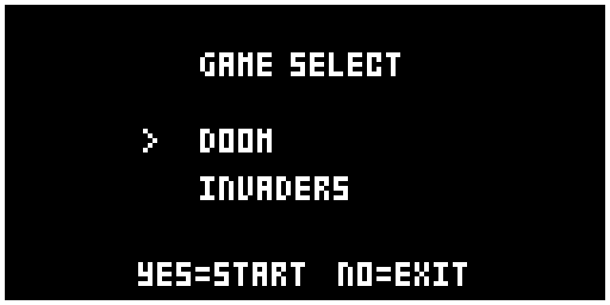
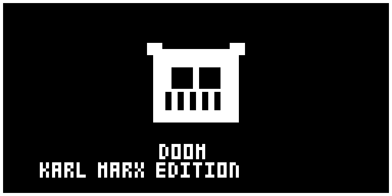
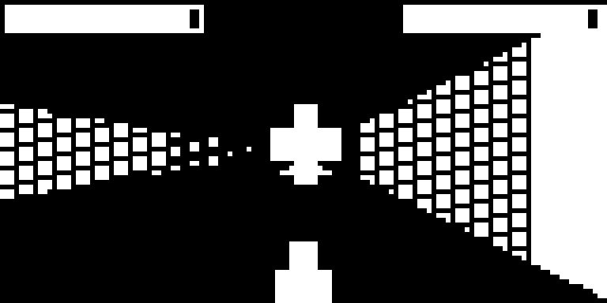
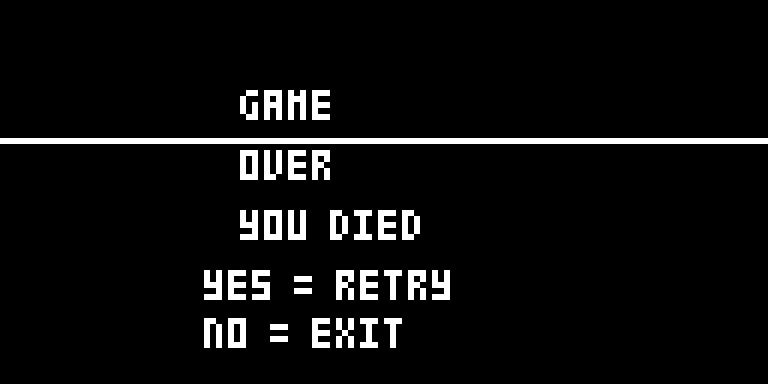
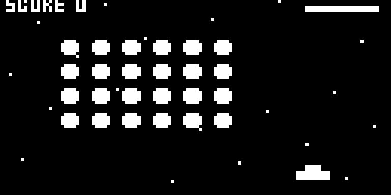
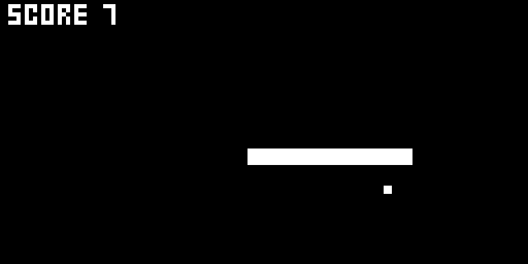

# DigiAlchemy GamePack - VOL.1

**A pocket arcade for the Elektron Digitone mk1 / Digitone Keys (OS 1.43).**
Three tiny games that run on the synth's 128×64 screen as one
[elekloader](https://github.com/irpina/elekloader) mod (`digidoom`). Press
**`MIDI+YES`** for the game-select menu, pick a game, and play with the arrow
keys and `YES`/`NO` — the instrument keeps running underneath, and the games
get out of the way when you close the menu.

- **DOOM** — a compact first-person raycaster (grid walls, 4×4 ordered-dither
  shading, z-buffered billboard sprites, HUD, weapon, doors, chasing monsters).
  A from-scratch engine, not the Doom engine.
- **INVADERS** — a very lightweight Space Invaders (a 6×4 fleet, a ship, one
  player bullet, alien fire, lives and a score).
- **SNAKE** — a grid snake that **grows and speeds up with every dot** it eats.

Status: **v0.21**. Built, linted, patched, and verified in **digiemu** (boots to
a live UI; the menu opens; all three games launch and play).

**Download:** grab the latest **release** — `DigiAlchemy-GamePack-<ver>.zip`
(the `.elemod` + install notes) or the bare `.elemod` — from
[Releases](https://github.com/DigiAlchemydsp/DigiAlchemy-GamePack-1/releases).
The `.elemod` is a linkable mod, not firmware; build the flashable `.syx`
locally (see *Build* below).

Launch trigger is **`MIDI+YES`** → the game-select menu:



DOOM — title, play, and game over:





Space Invaders:



Snake (grown, `SCORE 7`):



## Why this is a from-scratch engine, not a port of Doom

The reference is the RP2040 "Smallest-Doom" (a Chocolate Doom fork). A literal
port is not possible on the Digitone:

| | Smallest-Doom (RP2040) | Digitone mk1 elekloader mod |
|---|---|---|
| CPU / ISA | ARM Cortex-M0+ | ColdFire MCF5441x, m68k |
| Game data | `doom1.whx`, **1.8 MB**, mmap'd from flash | no bulk-storage path for a mod |
| Memory | 264 KB SRAM + flash | **128 KB total** for *all* mods (`.run`+`.bss`) |
| Display | 72×40 OLED | **128×64, 1-bit** |

So DIGIDOOM keeps the *spirit* of the tiny builds — a grid raycaster — and
reuses the ideas (DDA wall casting, camera plane, distance shading), not the
code. It fits in ~3 KB of the 128 KB budget.

## How it runs on the Digitone

It is an elekloader **format-2** mod (`mods/digidoom/`). It owns **no firmware
site**; it only subscribes to the core hook bus, so it combines with any other
mod:

| core event | rate | what DIGIDOOM does |
|---|---|---|
| `ev_draw(bmp, ctrl)` | per composed frame | clears the frame and draws the scene with the firmware's own `FILLRECT` / `VLINE` |
| `ev_tick(ctrl)` | 30 Hz | moves the player from the held keys, then sets `ctrl+0x20` to request a recompose |
| `ev_key(brain, ev)` | per key event | tracks held keys, toggles the game, swallows the game's keys while active |

Drawing with `FILLRECT`/`VLINE` (addresses `0x400DD292` / `0x400DC92C`, `y = 0`
is the **bottom** row) means no knowledge of the panel's memory layout is
needed. Distance shading is a **4×4 ordered dither** (separable: a column term
`(x&3)` and a row term `((row+off)&3)`, both under the level), drawn as short
`VLINE` runs; near walls are solid, far ones stipple. Floor and ceiling are left
black. Runs are naturally bounded because far walls are short.

Fixed point is Q15 throughout (1 world cell = 32768); there is no C library and
no float. The DDA is overflow-safe at that precision.

## Performance

The dominant cost is the **recompose**: forcing the firmware to redraw a frame
also redraws every stock view underneath us. So DIGIDOOM only requests a
recompose when the screen actually changes — on a fresh key press, on a slow
blink cadence for the title (~7 Hz), and at ~15 Hz while a game is running. The
static screens (menu, game-over) cost essentially nothing.

Measured in digiemu over a 20M-instruction window: **menu ≈ 4 draws / 128
ticks**; **INVADERS play ≈ 69 draws / 129 ticks** (i.e. half the 30 Hz tick).
If you want more headroom, change the `(g_ticks & 1)` test in `digidoom_tick`
to `(g_ticks & 3)` for ~10 Hz, or `(g_ticks & 7)` for ~7 Hz.

## Controls

Flow: **menu → (DOOM: title → play → game over) or (INVADERS: play → over)**.

| key | menu | DOOM | INVADERS | SNAKE |
|---|---|---|---|---|
| **YES** | launch | start · fire · retry | fire · retry | retry |
| **NO** | exit to the UI | menu · use door · menu | menu | menu |
| **UP / DOWN** | selection | move fwd / back | — | steer |
| **LEFT / RIGHT** | — | turn | move ship | steer |
| **FUNC + LEFT / RIGHT** | — | strafe | — | — |
| **MIDI + YES** | toggle on/off (the launch trigger, from any state) | | | |

- **DOOM**: `YES` fires (a black impact patch with an `x` on a hit, a `*` on the
  wall); `NO` opens a door.
- **INVADERS**: `YES` fires the ship's bullet; the fleet speeds up as it thins;
  3 lives and a score.
- **SNAKE**: arrows steer; each dot makes the snake **one segment longer and a
  little faster**; hitting a wall or yourself ends it.

Key codes are the measured Digitone runtime codes (`MIDI`=2, `YES`=13, `NO`=14,
`UP`=15, `DOWN`=16, `LEFT`=17, `RIGHT`=18). While active, DIGIDOOM swallows its
keys so the stock UI does not act on them.

## Build, lint, patch

```powershell
$env:PATH          = "C:\SysGCC\m68k-elf\bin;" + $env:PATH
$env:ELEKLOADER_CROSS = "m68k-elf-"
$env:PYTHONPATH    = "C:\Users\benan\Music\ELEKTRON\elekloader"
$stock = "C:\Users\benan\Music\ELEKTRON\Digitone_and_Digitone_Keys_OS1.43.syx"
$core  = "C:\Users\benan\Music\ELEKTRON\elekloader\mods\core-dn1\out\core-2.0a.elemod"

python -m elekloader.sdk.build mods\digidoom --stock $stock --out elemod
python -m elekloader.lint  elemod\digidoom-0.21.elemod --stock $stock --with $core
python -m elekloader.patch --stock $stock --mod $core `
    --mod elemod\digidoom-0.21.elemod `
    --out testout\test-digidoom-0.21.syx --version 0.1L
```

`--out elemod` writes the built mod straight into `elemod/`. (Builds also drop
a `elemod\digidoom.work\` dir, which is gitignored.)

Expect `BUILT`, `OK: links as core … > digidoom …` (≈15 KB of 128 KB), and
`WROTE` after `verified: …`.

## Testing in digiemu (what we did)

Boot/settle and screen capture use the emulator in `..\digiemu-main` with its
patched-Unicorn venv:

1. `python -m emu.portable --add testout\test-digidoom-0.5.syx --yes` boots,
   reaches "USER INTERFACE IS LIVE", and saves a `gui.snap`.
2. Resume that snapshot, inject panel keys with `emu.panelin`, and read the
   frame with `emu.panel.read(m, profile.fb_front)` / `panel.write_png`.
   Two gotchas: the snapshot's build manifest pins `unblock_except=(0x4137B93C,)`
   (the frame semaphore), and `emu.config` needs `DT2_SECTIONS` pointed at the
   firmware's extracted `sections/`.

**Note:** the emulator's display model cannot tolerate hooking the panel-present
entry points (`panel_diff`/`panel_flush`) — the *proven* DigiScreen overlay mod
fails to reach a live UI there too. That is why DIGIDOOM renders through
`ev_draw` instead. On hardware both approaches are the same technique.

## Layout

```
mods/digidoom/digidoom.c   the launcher + all three games (one file)
mods/digidoom/mod.json     the elemod manifest (ev_draw/ev_tick/ev_key, no sites)
elemod/                    the latest built mod (digidoom-0.21.elemod)
testout/                   emulator screenshots (the .syx builds are gitignored)
README.md                  this overview
HANDOFF.md                 working handoff (state, environment, testing recipe)
docs/GAME-MAKING.md        how to write a game on this platform (API + optimizations)
LICENSE / NOTICE           GPL-2.0-or-later; what is (and isn't) redistributed
```

Releases (a packaged `.zip` + the `.elemod`) live in the repo's **Releases**
section on GitHub.

## Roadmap

Done: the game-select menu (`MIDI+YES`); DOOM (raycaster, 4×4 dither, sprites,
HUD, weapon, fire, doors, monsters, title/game-over); INVADERS (fleet, ship,
bullets, lives, score, win/lose); SNAKE (grid snake that grows and speeds up).

- **Content**: more DOOM levels/monsters/weapons; INVADERS shields and a UFO;
  SNAKE a border and high score.
- **Sound**: none yet (the mod is display/UI only; the FM engine is untouched).

## Repository contents (and what isn't here)

This repo holds **our own code and assets**: the mod source
(`mods/digidoom/digidoom.c`), the built `.elemod`s, the docs, and screenshots.
It deliberately does **not** contain:

- **any firmware** — no stock or patched Elektron `.syx` files. You build the
  flashable image yourself from your own stock OS plus the `.elemod`s
  (`elekloader.patch`), so nothing proprietary is redistributed;
- the third-party **RP2040 "Smallest-Doom"** reference tree (Chocolate Doom /
  id shareware) — it is only a local reference, not part of this pack.

See `.gitignore`. The `.elemod` files reference firmware bytes by **address and
hash**, never by value (the elekloader format's rule), so they carry no firmware.

## Licence

GPL-2.0-or-later for our own code. Not affiliated with or endorsed by Elektron
or id Software.
